# Alden Khayoon

**Software developer · Toronto**

I just like building. I make interactive maps, data visualizations and practical web tools that turn complex information into something people can explore.

**Open to software engineering opportunities.**

Click any screenshot to try the project. Each card also links to its repository.

## Live applications

Interactive data and interfaces built for the web.

<table>
<tr>
<td width="50%" valign="top">
  <a href="https://khayoon.github.io/ontario-currents/">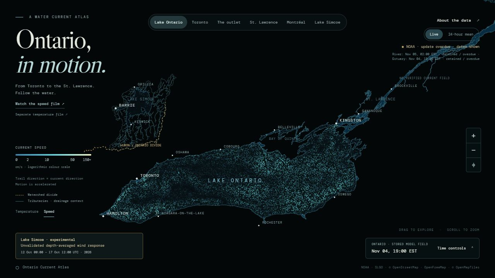</a>
  <h3><a href="https://khayoon.github.io/ontario-currents/">Ontario Current Atlas</a></h3>
  
Animated modelled currents, time controls and source-aware water data.

  
JavaScript · Canvas · Data pipelines

  
<a href="https://khayoon.github.io/ontario-currents/">Open live ↗</a> &nbsp;·&nbsp; <a href="https://github.com/Khayoon/ontario-currents">Repository</a>

</td>
<td width="50%" valign="top">
  <a href="https://khayoon.github.io/relief/">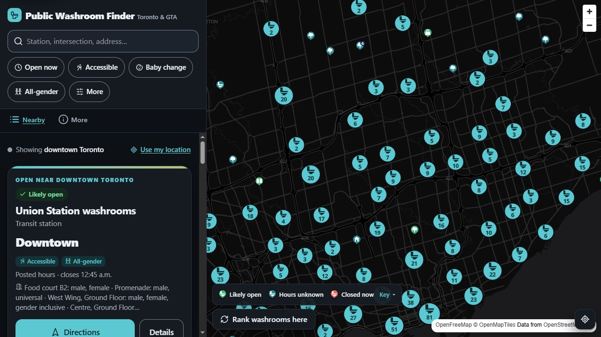</a>
  <h3><a href="https://khayoon.github.io/relief/">Public Washroom Finder</a></h3>
  
Find Toronto &amp; GTA washrooms by location, hours and accessibility.

  
JavaScript · PWA · GeoJSON

  
<a href="https://khayoon.github.io/relief/">Open live ↗</a> &nbsp;·&nbsp; <a href="https://github.com/Khayoon/relief">Repository</a>

</td>
</tr>
<tr>
<td width="50%" valign="top">
  <a href="https://khayoon.github.io/Neurotrino/">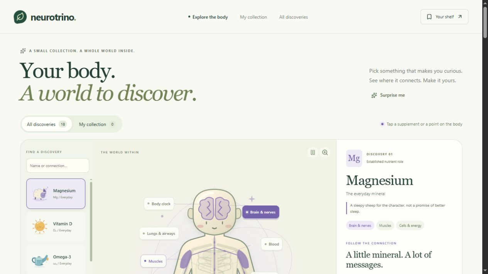</a>
  <h3><a href="https://khayoon.github.io/Neurotrino/">Neurotrino</a></h3>
  
An illustrated supplement field guide with sources and saved collections.

  
Next.js · React · TypeScript · Static public edition

  
<a href="https://khayoon.github.io/Neurotrino/">Open live ↗</a> &nbsp;·&nbsp; <a href="https://github.com/Khayoon/Neurotrino">Repository</a>

</td>
<td width="50%" valign="top">
  <a href="https://khayoon.github.io/first-fields/">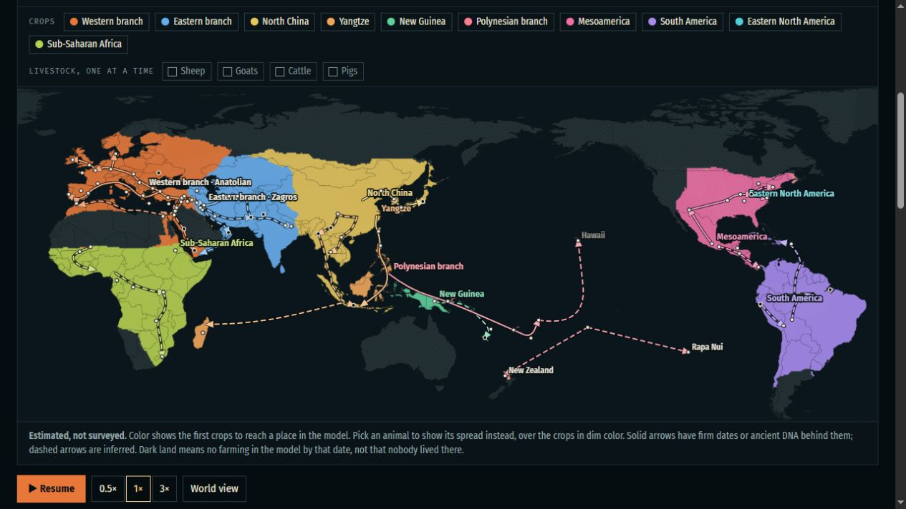</a>
  <h3><a href="https://khayoon.github.io/first-fields/">The First Fields</a></h3>
  
An illustrative atlas of agriculture’s spread with timeline playback and crop and livestock layers.

  
JavaScript · Canvas · Animated cartography

  
<a href="https://khayoon.github.io/first-fields/">Open live ↗</a> &nbsp;·&nbsp; <a href="https://github.com/Khayoon/Khayoon.github.io/tree/main/first-fields">Repository</a>

</td>
</tr>
<tr>
<td width="50%" valign="top">
  <a href="https://khayoon.github.io/upstream-atlas/">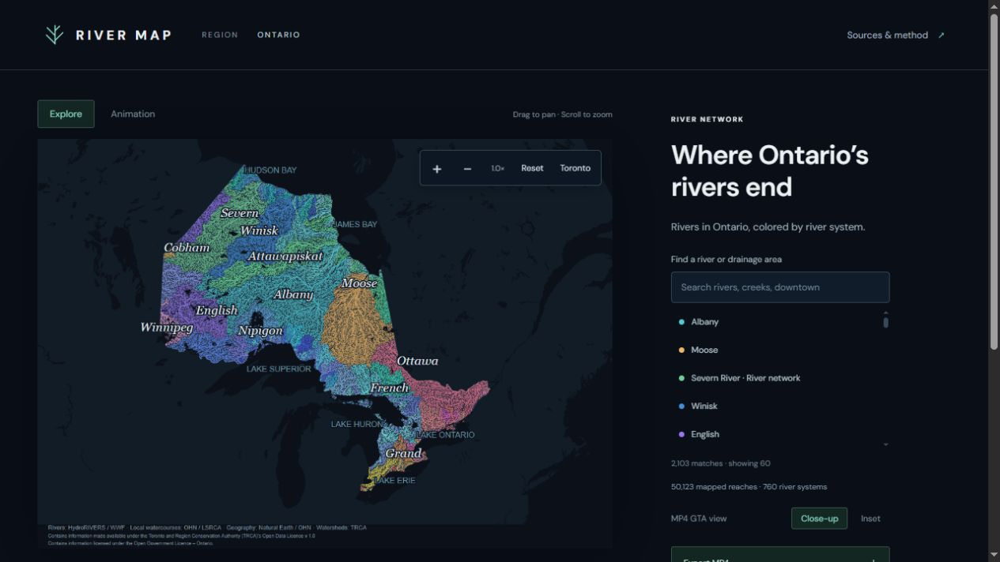</a>
  <h3><a href="https://khayoon.github.io/upstream-atlas/">Upstream Atlas</a></h3>
  
Explore Ontario river systems and export animated maps as MP4.

  
Interactive cartography · Canvas · Video export

  
<a href="https://khayoon.github.io/upstream-atlas/">Open live ↗</a> &nbsp;·&nbsp; <a href="https://github.com/Khayoon/upstream-atlas">Repository</a>

</td>
<td width="50%" valign="top">
  <a href="https://imhomeless.ca/">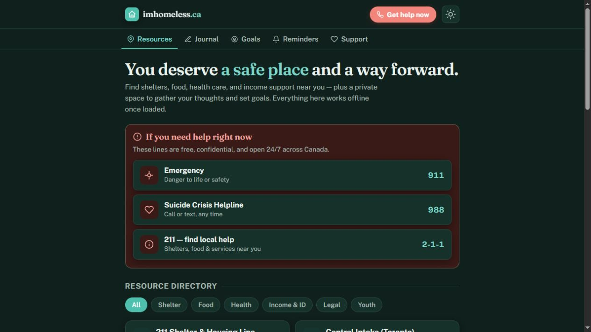</a>
  <h3><a href="https://imhomeless.ca/">imhomeless.ca</a></h3>
  
Canadian support resources, a private journal and personal goals.

  
HTML · CSS · JavaScript · Browser storage

  
<a href="https://imhomeless.ca/">Open live ↗</a> &nbsp;·&nbsp; <a href="https://github.com/Khayoon/imhomeless.ca">Repository</a>

</td>
</tr>
</table>

## Maps & visual stories

Geography, language, natural systems and history — made explorable.

<table>
<tr>
<td width="50%" valign="top">
  <a href="https://khayoon.github.io/Peopling-of-the-Planet-Earth-Mapped/">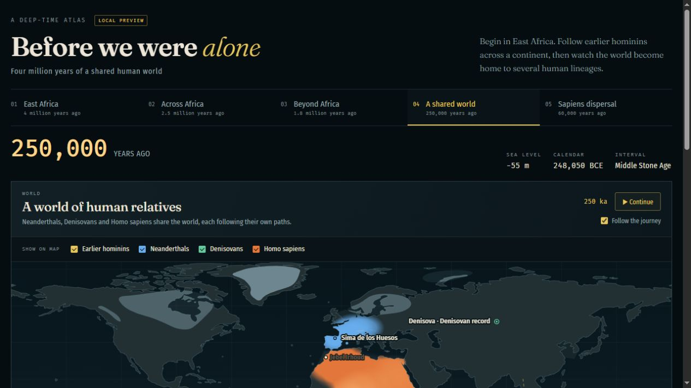</a>
  <h3><a href="https://khayoon.github.io/Peopling-of-the-Planet-Earth-Mapped/">Before We Were Alone</a></h3>
  
A deep-time human-history atlas with an animated timeline and fossil evidence.

  
JavaScript · Canvas · Educational modelling

  
<a href="https://khayoon.github.io/Peopling-of-the-Planet-Earth-Mapped/">Open live ↗</a> &nbsp;·&nbsp; <a href="https://github.com/Khayoon/Peopling-of-the-Planet-Earth-Mapped">Repository</a>

</td>
<td width="50%" valign="top">
  <a href="https://khayoon.github.io/snow-bunting/">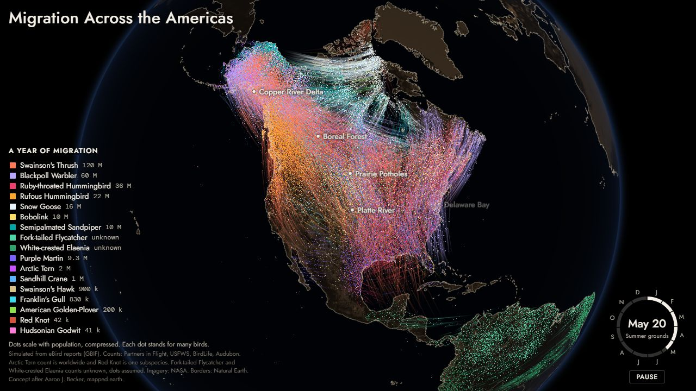</a>
  <h3><a href="https://khayoon.github.io/snow-bunting/">Snow Bunting</a></h3>
  
A year of bird migration across the Americas, simulated from eBird reports.

  
JavaScript · Canvas · Data visualization

  
<a href="https://khayoon.github.io/snow-bunting/">Open live ↗</a> &nbsp;·&nbsp; <a href="https://github.com/Khayoon/snow-bunting">Repository</a>

</td>
</tr>
<tr>
<td width="50%" valign="top">
  <a href="https://khayoon.github.io/olive-growing-atlas/">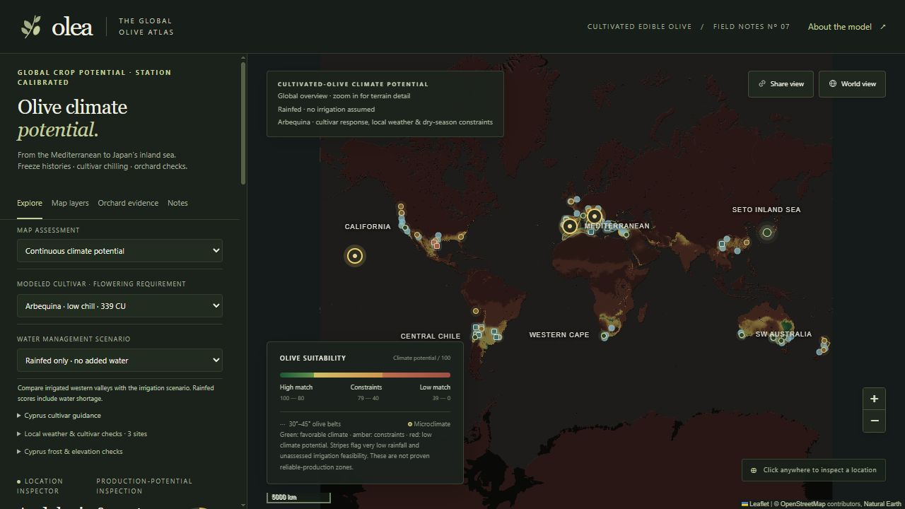</a>
  <h3><a href="https://khayoon.github.io/olive-growing-atlas/">Olea — The Global Olive Atlas</a></h3>
  
Compare modelled olive climate potential by cultivar and water scenario.

  
JavaScript · Leaflet · GeoTIFF

  
<a href="https://khayoon.github.io/olive-growing-atlas/">Open live ↗</a> &nbsp;·&nbsp; <a href="https://github.com/Khayoon/olive-growing-atlas">Repository</a>

</td>
<td width="50%" valign="top">
  <a href="https://khayoon.github.io/lake-ontario-temperature/">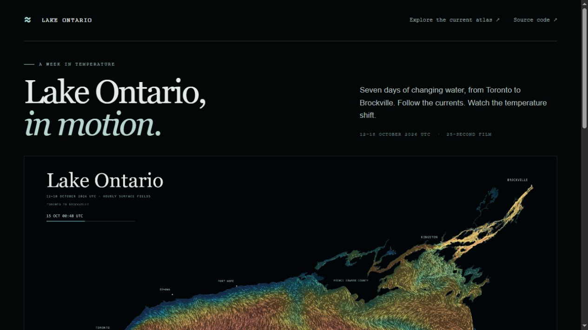</a>
  <h3><a href="https://khayoon.github.io/lake-ontario-temperature/">Lake Ontario, in Motion</a></h3>
  
A reproducible film of temperature-coloured currents, 12–18 October 2026.

  
Canvas · Node.js · FFmpeg · Dated model study

  
<a href="https://khayoon.github.io/lake-ontario-temperature/">Open live ↗</a> &nbsp;·&nbsp; <a href="https://github.com/Khayoon/lake-ontario-temperature">Repository</a>

</td>
</tr>
<tr>
<td width="50%" valign="top">
  <a href="https://khayoon.github.io/snow-word-atlas/">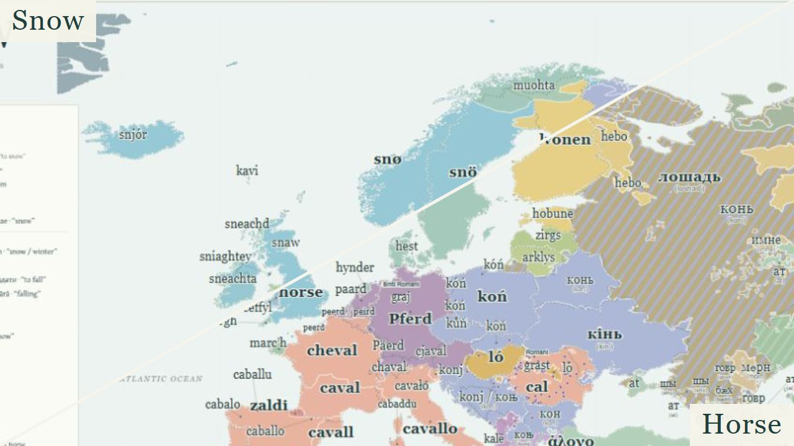</a>
  <h3>Word Atlases</h3>
  
Explore snow and horse words, native scripts and word origins across Europe and its neighbours.

  
D3 · SVG · GeoJSON · High-resolution export

  
<a href="https://khayoon.github.io/snow-word-atlas/">Snow ↗</a> &nbsp;·&nbsp; <a href="https://khayoon.github.io/horse-word-atlas/">Horse ↗</a> Repositories: <a href="https://github.com/Khayoon/snow-word-atlas">Snow</a> &nbsp;·&nbsp; <a href="https://github.com/Khayoon/horse-word-atlas">Horse</a>

</td>
<td width="50%" valign="top">
  <a href="https://khayoon.github.io/eastern-farming-expansion/">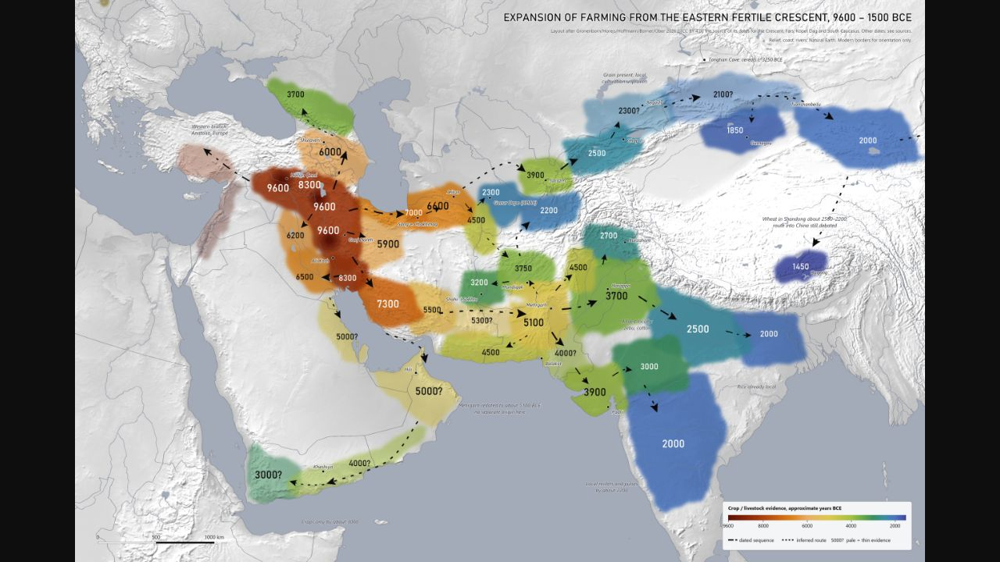</a>
  <h3><a href="https://khayoon.github.io/eastern-farming-expansion/">Eastern Farming Expansion</a></h3>
  
A dated map of farming’s eastern spread, with archaeological evidence and uncertainty notes.

  
Python · Pillow · pyproj · Static cartography

  
<a href="https://khayoon.github.io/eastern-farming-expansion/">Open live ↗</a> &nbsp;·&nbsp; <a href="https://github.com/Khayoon/eastern-farming-expansion">Repository</a>

</td>
</tr>
<tr>
<td width="50%" valign="top">
  <a href="https://khayoon.github.io/greek-gods-atlas/atlas/">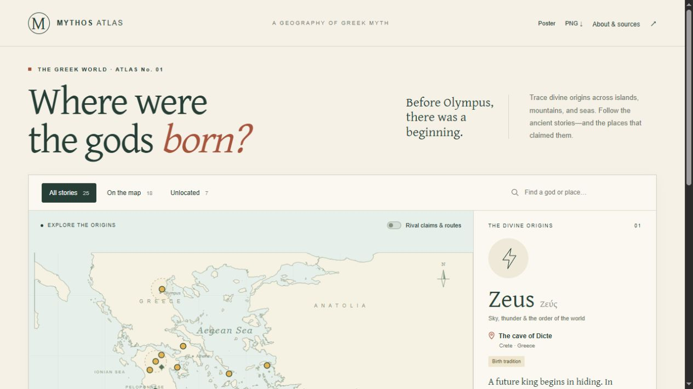</a>
  <h3><a href="https://khayoon.github.io/greek-gods-atlas/atlas/">Greek Myth Atlas</a></h3>
  
Explore divine-origin traditions, rival claims and ancient sources.

  
JavaScript · SVG · Research &amp; visual storytelling

  
<a href="https://khayoon.github.io/greek-gods-atlas/atlas/">Open live ↗</a> &nbsp;·&nbsp; <a href="https://github.com/Khayoon/greek-gods-atlas">Repository</a>

</td>
<td width="50%" valign="top">
  <a href="https://khayoon.github.io/mesopotamian-gods-atlas/">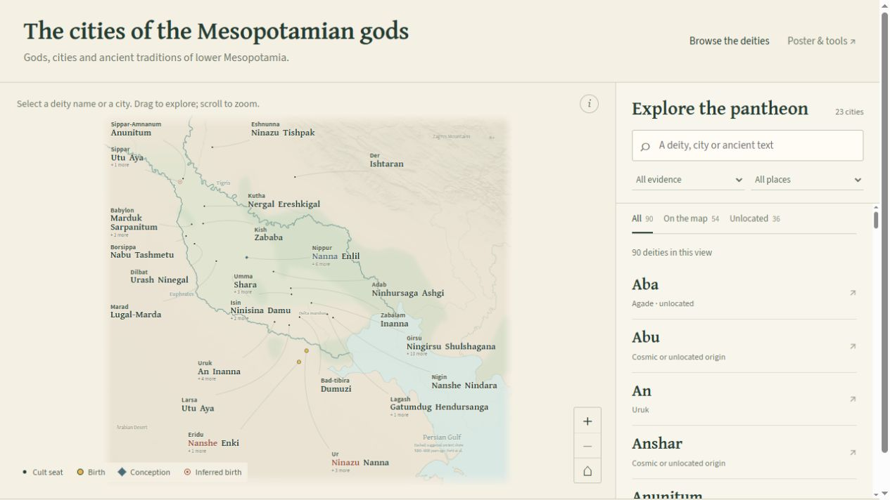</a>
  <h3><a href="https://khayoon.github.io/mesopotamian-gods-atlas/">Mesopotamian Gods Atlas</a></h3>
  
Browse 90 deity records, cult cities and ancient traditions.

  
JavaScript · SVG · Searchable research catalogue

  
<a href="https://khayoon.github.io/mesopotamian-gods-atlas/">Open live ↗</a> &nbsp;·&nbsp; <a href="https://github.com/Khayoon/mesopotamian-gods-atlas">Repository</a>

</td>
</tr>
</table>

## Prototypes & experiments

A few more things I enjoyed building.

<table>
<tr>
<td width="50%" valign="top">
  <a href="https://khayoon.github.io/treeiscompany/">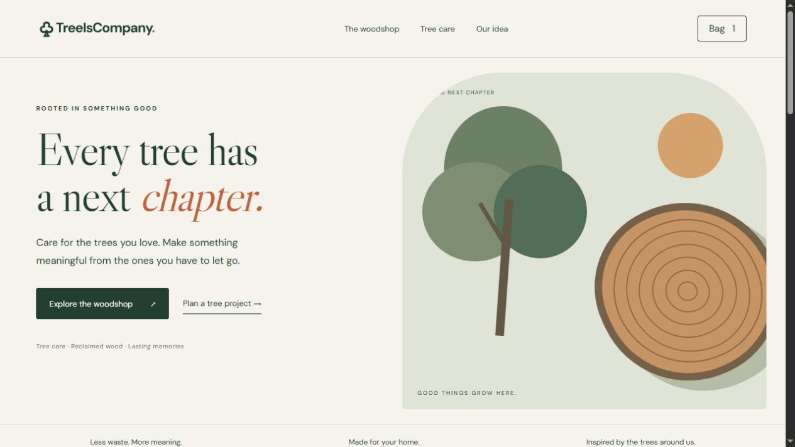</a>
  <h3><a href="https://khayoon.github.io/treeiscompany/">TreeIsCompany</a></h3>
  
A tree-care and reclaimed-wood marketplace prototype with a saved bag.

  
HTML · CSS · JavaScript · PWA prototype

  
<a href="https://khayoon.github.io/treeiscompany/">Open live ↗</a> &nbsp;·&nbsp; <a href="https://github.com/Khayoon/treeiscompany">Repository</a>

</td>
<td width="50%" valign="top">
  <a href="https://khayoon.github.io/dragonbreath-play/">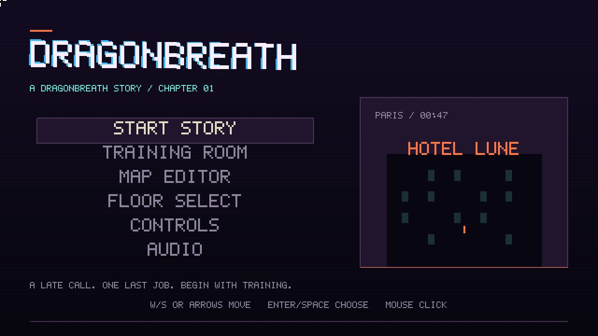</a>
  <h3><a href="https://khayoon.github.io/dragonbreath-play/">Dragonbreath</a></h3>
  
A pixel-art browser game with story, training and map-editor modes.

  
Browser game · Playable build

  
<a href="https://khayoon.github.io/dragonbreath-play/">Open live ↗</a> &nbsp;·&nbsp; <a href="https://github.com/Khayoon/dragonbreath-play">Repository</a>

</td>
</tr>
<tr>
<td width="50%" valign="top">
  <a href="https://khayoon.github.io/canada-noise-map/">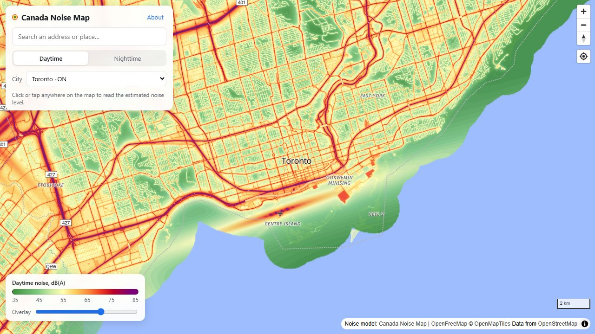</a>
  <h3><a href="https://khayoon.github.io/canada-noise-map/">Canada Noise Map</a></h3>
  
Explore estimated daytime and nighttime transportation noise.

  
JavaScript · MapLibre GL · PMTiles

  
<a href="https://khayoon.github.io/canada-noise-map/">Open live ↗</a> &nbsp;·&nbsp; <a href="https://github.com/Khayoon/canada-noise-map">Repository</a>

</td>
<td width="50%" valign="top">
  <h3>More code to explore</h3>
  
Local tools with public repositories:

  
<a href="https://github.com/Khayoon/studybook-local-rag"><strong>Studybook</strong></a> Document retrieval, source-linked study guides and quizzes. Python · FastAPI · LangChain · Chroma

  
<a href="https://github.com/Khayoon/voice-clipper"><strong>Voice Clipper</strong></a> A Windows utility for collecting and exporting voice-training clips. Python · WASAPI · WAV export

  
<a href="https://github.com/Khayoon/Traveltimevisualizer"><strong>Ontario Drive-Time Explorer</strong></a> Road-network routing and progressive travel-time reachability. Web Workers · Dijkstra · Leaflet · Canvas

</td>
</tr>
</table>

Some repositories contain published builds; project notes describe the available source and data. Screenshots captured November 2026.
